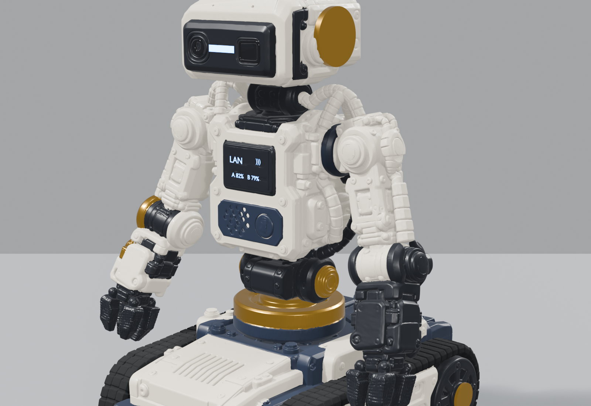
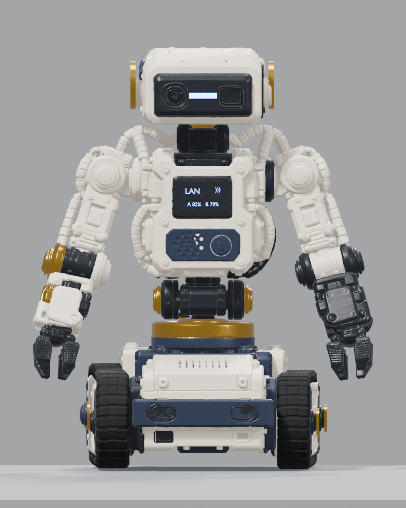
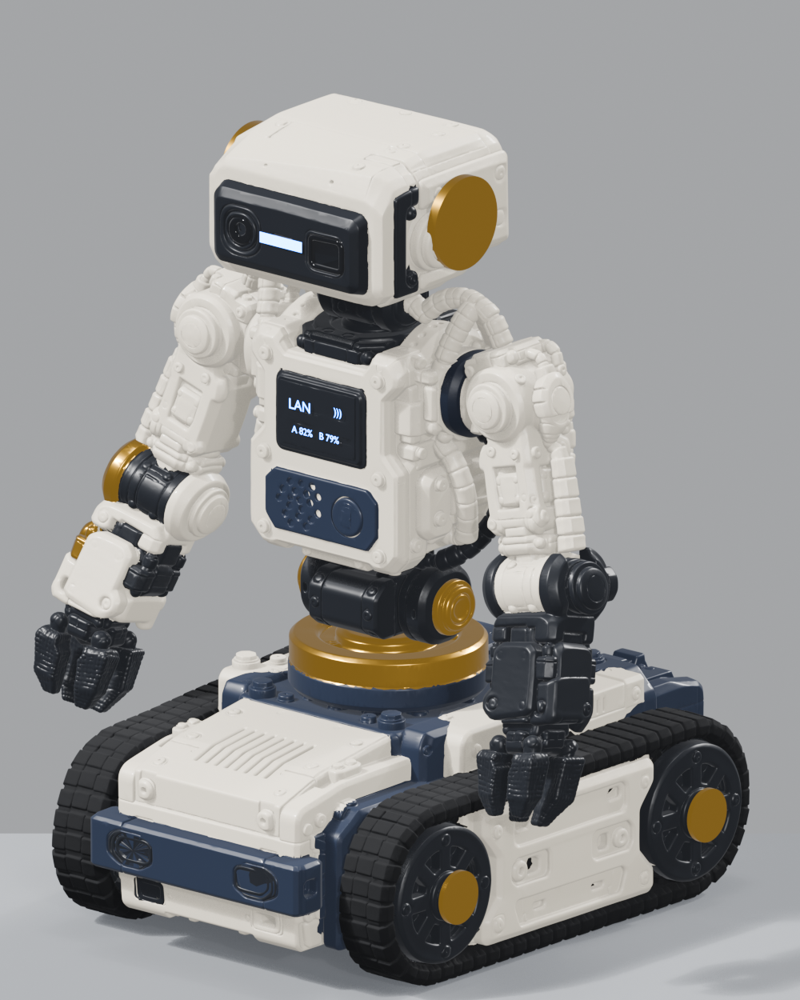
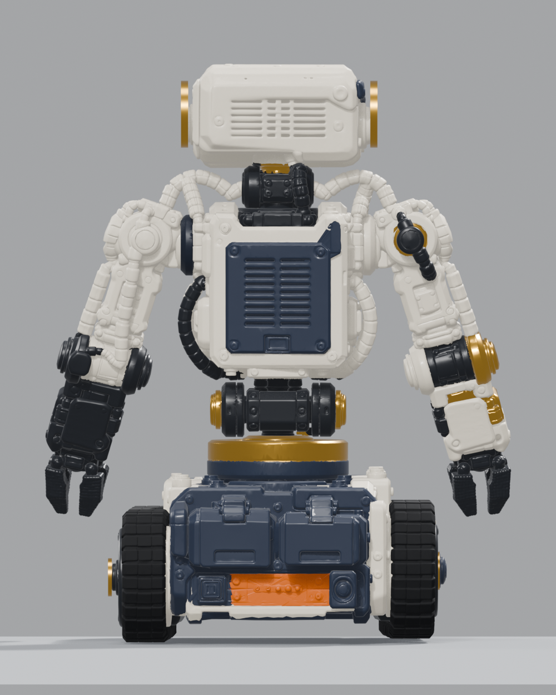

# Galahad — tracked desktop companion robot



Galahad is a small, open-source, tracked companion robot: a desk-sized machine
that can keep you company, talk, and pick up light objects. Think Butter Bot,
but built from real, orderable parts.

This repository is the **design and engineering source of truth**: the CAD model,
the joint map, the URDF, the bill of materials and the build notes. Firmware and
the full ROS 2 control stack come next on the roadmap.

> **Status: M1 — CAD and kinematics.** The model, materials, rig, URDF and
> documentation exist and are reproducible. Nothing here has been physically
> built, printed, powered or measured yet. Every number marked *estimate* still
> needs a bench result behind it.

---

## The model

| Front | Isometric | Back |
|---|---|---|
|  |  |  |

- 93 named parts across 6 subsystem collections, 1.9 M triangles
- Ivory printed shells, midnight-navy service plates, graphite DYNAMIXEL
  housings, brass fittings, near-black silicone treads
- Rigged to an 18-bone armature with rigid per-part skinning: the parked pose is
  the rest pose, so posing cannot distort the geometry
- Chest display reads `LAN / A 82% B 79%`; head carries the camera, ToF imager,
  status LED and brass side bosses
- Rear service bay with two battery cartridges and an orange latch plate

## Parked envelope

| Dimension | Value | Brief target |
|---|---|---|
| Height | 240.0 mm | ~240 mm |
| Width (across folded arms) | 194.6 mm | ~200 mm |
| Depth | 186.1 mm | 145–180 mm |

The depth is **6 mm over the target band** and inside the 250 mm absolute limit.
The mast and the rear battery handles are the contributors; fixing it means
shortening the rear service bay by ~8 mm or moving the cartridges to the side
skins. Do not shrink the printed parts to close this gap — change the packaging.

## Degrees of freedom

14 articulation actuators plus two independent tread drives:

```
base_link
├── tread_L, tread_R                    2 × Pololu 100:1 micro metal gearmotor
├── waist_yaw      XC330-M288   ±90°
│   └── waist_pitch XC330-M288  ±20°    ← critical feasibility gate
│       └── torso (fixed structure)
│           ├── head_pan   XL330-M288  ±80°
│           │   └── head_tilt XL330-M288 −25…+35°
│           ├── shoulder_yaw_L  XC330-M288   ±80°
│           │   └── shoulder_pitch_L XC330-M288 −100…+95°
│           │       └── elbow_L XC330-M288 −120…+90°
│           │           └── wrist_L XL330-M288 ±90°
│           │               └── gripper_L XL330-M288 0…55°
│           └── shoulder_yaw_R … (mirror)
```

8 × `XC330-M288-T` and 6 × `XL330-M288-T`. The low-voltage **M288** variants —
not the T288. See [docs/SPECIFICATION.md](docs/SPECIFICATION.md).

## Repository layout

```
blender/                 CAD source and build scripts
  galahad.blend          full scene: geometry, materials, rig, studio
  galahad.glb            portable export (1.9 M tris, materials)
  scripts/               reproducible build + render pipeline
docs/
  SPECIFICATION.md       dimensions, joints, mass/power budgets
  BOM.md                 sourced bill of materials and price anchors
  ROADMAP.md             milestone plan and current status
  MODEL_NOTES.md         how the model was built, and where it deviates
  joint_map.json         machine-readable rig export (frames, parts, bounds)
  images/                turnaround + hero renders
ros2_ws/src/
  galahad_description/   URDF, xacro, launch, RViz config, joint limits
tools/
  gen_urdf.py            joint map -> URDF generator
  blender_bridge_addon.py main-thread-safe Blender socket bridge
```

## Quick start

**Look at the model.** Open `blender/galahad.blend` in Blender 4.2+ (built in
5.2), or drop `blender/galahad.glb` into any glTF viewer.

**Regenerate the URDF** after moving a joint in Blender:

```bash
python tools/gen_urdf.py
```

**View it in ROS 2** (Jazzy) — *not yet executed: no ROS 2 install on the build
machine, so this path is written but unverified*:

```bash
colcon build --packages-select galahad_description
source install/setup.bash
ros2 launch galahad_description display.launch.py
```

**Rebuild the whole scene from the reference mesh** (needs Blender on `PATH`):

```bash
blender -b -P blender/scripts/build_from_scratch.py
blender -b blender/galahad.blend -P blender/scripts/final_renders.py
```

## What is modelled vs. what is guessed

Being explicit matters more than looking finished.

| Item | Status |
|---|---|
| Geometry, part names, hierarchy | Modelled from the supplied reference mesh |
| Materials and colour scheme | Modelled from the six reference renders |
| Joint positions | Modelled; pivots placed from the geometry |
| Joint limits | Design targets, not measured |
| Link masses / inertia | Engineering estimates summing to 1.25 kg — unverified |
| Actuator torque, current, speed | Manufacturer figures, not bench-verified |
| Power tree, runtime | Paper design — no scope traces exist |
| Pickup, driving, thermal results | Not tested; no hardware built |

The engineering brief that drives these decisions lives with the project lead;
every claim above inherits the `[spec] / [calc] / [target] / [assumption]`
discipline it asks for.

## Roadmap

M0 compatibility audit · **M1 CAD + kinematics (current)** · M2 bench proof of
one servo, MCU and U2D2 · M3 calibrated tread drive · M4 arm + waist mockup ·
M5 full 14-joint assembly · M6 supervised 20 g floor pickup · M7 voice and LAN
co-work · M8 dual-input exchange · M9 Isaac/dock work.

Details in [docs/ROADMAP.md](docs/ROADMAP.md).

## Licence

MIT — see [LICENSE](LICENSE). The reference artwork and the supplied `.3mf`
mesh remain the property of their author; this repository ships a derived CAD
scene for non-commercial prototyping. Confirm rights before commercial use.
