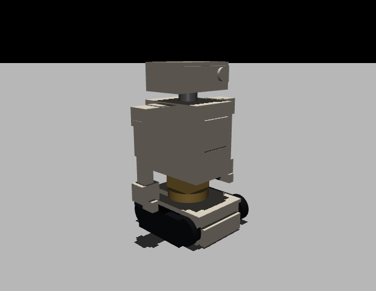

# Sim2real model — Polykrom → MuJoCo / ROS

The simulation-ready Galahad: parametric CAD in [Polykrom](https://github.com/WCKDai/polykrom),
exported to MJCF and URDF with mass, inertia, joint limits and actuator ratings.



## What ships

| File | What |
|---|---|
| `design/galahad.polykrom` | Polykrom source design — 18 components, 16 joints |
| `design/galahad.json` | the generated command script that builds it |
| `design/galahad.mjcf` + `galahad-*.stl` | MuJoCo model, one STL per link |
| `design/galahad.urdf` + `galahad-*.stl` | ROS / Isaac / PyBullet description |
| `docs/mujoco_report.json` | the validation report below |

Regenerate everything:

```bash
python tools/build_sim_model.py
```

## Conventions

Millimetres, degrees, **+X forward, +Y left, +Z up**, ground at z = 0.
The parked design stands on its tracks at the origin.

## Kinematic tree

18 links, 16 moving joints (14 articulation + 2 tread drives), one rigid weld.

```
base_link                    root, tracks on the ground
├── rear_panel               fixed link (also absorbs a Polykrom export quirk)
├── tread_L / tread_R        revolute about Y at the rear axle
└── waist                    revolute Z, ±90°      waist_yaw      XC330
    └── torso                revolute Y, ±20°      waist_pitch    XC330
        ├── neck             revolute Z, ±80°      head_pan       XL330
        │   └── head         revolute Y, −25…+35°  head_tilt      XL330
        └── shoulder_L/R     revolute Z, ±80°      shoulder_yaw   XC330
            └── upperarm     revolute Y, −100…+95° shoulder_pitch XC330
                └── forearm  revolute Y, −120…+90° elbow          XC330
                    └── hand revolute Y, ±90°      wrist          XL330
                        └── jaw  revolute X, 0…45° gripper        XL330
```

Joint origins, axes and ranges come from the CAD; the URDF and MJCF are
generated from the same assembly, so they cannot drift apart.

## Mass

Measured in the exported MJCF: **1.259 kg** (brief target 0.9–1.3 kg).

| Link | Mass | Link | Mass |
|---|---|---|---|
| base_link | 409 g | shoulder (each) | 50 g |
| torso | 301 g | upperarm (each) | 45 g |
| head | 98 g | hand (each) | 35 g |
| waist | 67 g | forearm (each) | 31 g |
| tread (each) | 18 g | jaw (each) | 9.5 g |
| neck | 10 g | | |

Masses come from modelled volume × material density. Printed shells are modelled
as solids, so shell materials use **effective densities** (0.40 g/cm³ for the
ivory shells, 0.24 for the tracks) chosen so the solid volume reproduces the real
part mass. Arm links carry their DYNAMIXEL inside and use higher effective
densities (1.1–3.8 g/cm³). None of these are measured — they are the budget from
[docs/SPECIFICATION.md](SPECIFICATION.md) expressed as density.

## Actuators

Polykrom writes one global `effort` for joints that no library servo drives, and
ROBOTIS XC330/XL330 are not in its parts library (the links are envelopes at the
real 20 × 34 × 26 mm size). `tools/patch_mjcf.py` restores the datasheet stall
torques per joint after export:

| Joints | Actuator | Force limit |
|---|---|---|
| waist yaw/pitch, shoulder yaw/pitch, elbow ×2 | XC330-M288-T | ±0.93 N·m |
| head pan/tilt, wrist ×2, gripper ×2 | XL330-M288-T | ±0.52 N·m |
| tread drives | Pololu 100:1 HPCB | ±0.157 N·m |

These are **stall** ratings, not continuous ratings. For long-duty simulation run
`tools/patch_mjcf.py --scale 0.3` to cap at 30 % of stall until thermal data
exists — the brief's own guidance for the waist-pitch gate.

## Validation (MuJoCo 3.17)

From `docs/mujoco_report.json`:

| Check | Result |
|---|---|
| Loads and compiles | 19 bodies, 17 joints, 16 actuators, 17 meshes |
| Total mass | 1.259 kg |
| Massless links | none |
| Settles on the floor from the design pose (2 s) | −1.75 mm, 2.22° tilt, 10 contacts |
| Peak contact force | 0.39 N |
| Tread roll, 2 s ramp to 4 rad | 9.5 mm forward, 2.3° tilt, treads turned 19° / 99° |

**This is a software check, not a hardware result.** It shows the model loads,
has plausible mass and does not explode; it does not show the robot drives well.

## Known limitations

1. **Tracks are rigid stadium bodies, not belts.** MuJoCo collides the convex
   hull, so the tread is a rounded wheel. Skid-steer slip, belt compliance and
   track derailment are not represented, and the 9.5 mm roll above is the
   clearest symptom. This is the single biggest sim2real gap: the brief calls for
   a belt/link contact model and friction calibration against real driving.
2. **Visuals are boxes.** This model exists for physics and TF, not looks. The
   high-fidelity asset is `blender/galahad.glb`.
3. **No sensors in the model.** Camera, ToF, IMU and bumper frames are not in the
   MJCF yet; the ROS TF tree and sensor suite are still to be added.
4. **Actuator dynamics are a position servo.** No backlash, thermal model,
   current limit or communication delay — all listed as required by the brief.
5. **Polykrom export drops the joint on the first child of the root body.** The
   `rear_panel` link is created first and welded intentionally so the real joints
   survive. Re-ordering components may bring the bug back.

## Loading it

```python
import mujoco
model = mujoco.MjModel.from_xml_path("design/galahad.mjcf")
data = mujoco.MjData(model)
mujoco.mj_resetDataKeyframe(model, data, 0)   # the design pose, actuators holding it
```

```bash
# ROS 2
ros2 run robot_state_publisher robot_state_publisher --ros-args -p robot_description:="$(cat design/galahad.urdf)"
```

The URDF writes meshes next to itself, so load it from `design/` (or pass
`mesh_prefix` to the export for a `package://` path).
